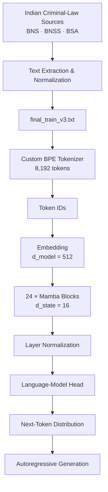
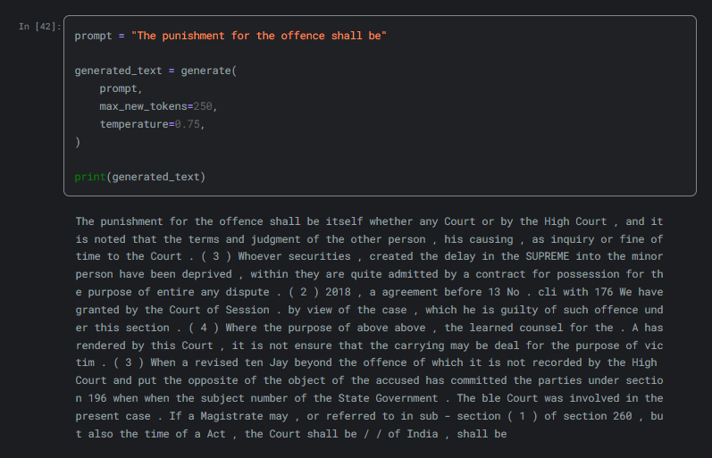
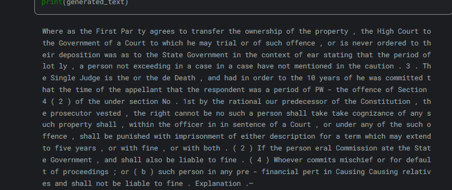

<div align="center">

# ⚖️ Legal-Mamba

### A 44.9M-Parameter Mamba Language Model for Indian Criminal Law

[](https://www.python.org/)
[](https://pytorch.org/)
[](https://arxiv.org/abs/2312.00752)
[](LICENSE)
[](https://www.kaggle.com/code/namanchanana/legal-mamba-training-on-indian-criminal-law)

[](https://github.com/Rishy-09/legal-mamba-indian-criminal-law/actions/workflows/ci.yml)

**A compact autoregressive State Space language model trained from scratch on a curated corpus of Indian criminal-law text.**

</div>

<p align="center">
  
</p>

---

## Overview

**Legal-Mamba** explores the use of **Selective State Space Models (SSMs)** for domain-specific legal language modelling.

Instead of wrapping an existing hosted LLM, the project implements the core pipeline directly:

```text
BNS · BNSS · BSA
       ↓
Legal Document Processing
       ↓
Curated Training Corpus
       ↓
Custom BPE Tokenizer
       ↓
44.88M-Parameter Mamba
       ↓
Autoregressive Training
       ↓
Checkpoint + Loss Tracking
       ↓
Legal-Style Text Generation
```

The repository contains the model implementation, corpus-preparation utilities, tokenizer, training corpus, training loop, loss history, checkpoint information, and generation examples required to inspect the experiment end to end.

> **Research scope:** Legal-Mamba is an educational and experimental language-model project. It is **not a legal-advice system** and should not be used for legal interpretation, legal decision-making, or professional advice.

---

## Project at a Glance

| Component | Value |
| --- | --- |
| **Architecture** | Mamba / Selective State Space Model |
| **Trainable Parameters** | **44.88M** |
| **Mamba Layers** | **24** |
| **Hidden Dimension** | **512** |
| **State Dimension** | **16** |
| **Context Length** | **256 tokens** |
| **Vocabulary Size** | **8,192** |
| **Batch Size** | **8** |
| **Training Steps** | **300** |
| **Optimizer** | AdamW |
| **Learning Rate** | `3e-4` |
| **LR Schedule** | Cosine Annealing |
| **Training Objective** | Autoregressive next-token prediction |
| **Training Platform** | Kaggle / CUDA when available |
| **Final Recorded Loss** | **4.191** |
| **Best Recorded Loss** | **3.742** |
| **License** | Apache License 2.0 |
| **Automated Tests** | **7 CPU sanity/reproducibility tests** |

---

## Training Result

The repository preserves the complete 300-step loss history in [`results/loss_history.csv`](results/loss_history.csv).

| Training Signal | Value |
| --- | ---: |
| Initial loss | **10.112** |
| Final loss | **4.191** |
| Best recorded loss | **3.742** |
| Best-loss step | **225** |
| Initial → final reduction | **58.6%** |
| Recorded steps | **300** |

<p align="center">
  
</p>

The curve demonstrates substantial optimization during the short experimental run. Loss is not strictly monotonic—as expected with mini-batch stochastic training—but the overall trajectory falls strongly from the initial value.

This result should be interpreted as **training evidence**, not as a formal language-model benchmark. The current project does not report held-out perplexity or downstream legal-task evaluation.

---

## Why Mamba?

Transformer language models rely heavily on self-attention, whose computational and memory requirements grow quadratically with sequence length.

**Mamba** replaces attention with Selective State Space mechanisms designed for efficient sequence modelling with linear scaling in sequence length.

That makes the architecture particularly interesting for domains such as legal text, where documents can be long and structurally complex.

Legal-Mamba uses Mamba as a compact experimental architecture rather than attempting to compete with production-scale legal LLMs.

---

## Architecture



The training configuration instantiates a 24-layer Mamba model with an 8,192-token vocabulary and 512-dimensional hidden representation.

The resulting model contains approximately **44.88 million trainable parameters**.

---

## Legal Corpus

The repository contains source material corresponding to major Indian criminal-law legislation:

```text
data/
├── bns.pdf
├── bnss.pdf
└── bsa.pdf
```

These sources are processed and consolidated into:

```text
data/final_train_v3.txt
```

The final corpus is approximately:

| Corpus Property | Value |
| --- | ---: |
| File size | **~3.10 MB** |
| Words | **~518,604** |
| Domain | Indian criminal law |

The corpus-preparation pipeline includes extraction, cleaning, normalization, and consolidation before tokenizer/model training.

> Users extending the corpus are responsible for ensuring that additional material can be used in accordance with applicable terms, copyright, and licensing requirements.

---

## Custom Tokenizer

Legal-Mamba uses a custom-trained **BPE tokenizer** rather than a tokenizer inherited from a general-purpose pretrained model.

```text
data/tokenizer.json
```

Vocabulary size:

```text
8,192 tokens
```

A domain-specific tokenizer provides a vocabulary shaped by the project's legal corpus and reduces unnecessary fragmentation of recurring domain terminology.

---

## Training Pipeline

Training is implemented in [`src/train.py`](src/train.py).

```text
final_train_v3.txt
        ↓
Custom Tokenizer
        ↓
Random 256-Token Sequences
        ↓
Batch Size = 8
        ↓
44.88M Mamba Model
        ↓
Cross-Entropy Loss
        ↓
Backpropagation
        ↓
Gradient Clipping (1.0)
        ↓
AdamW
        ↓
Cosine LR Schedule
        ↓
Loss History + Checkpoints
```

The current implementation includes:

- autoregressive next-token prediction
- random sequence sampling
- AdamW optimization
- gradient clipping
- cosine-annealing learning-rate scheduling
- periodic checkpoint saving
- complete training-loss recording
- CUDA execution when available

The implementation intentionally keeps the optimization loop compact and inspectable.

---

## Checkpoints

During training, intermediate checkpoints are written every 50 steps after the initial step:

```text
model_step_50.pth
model_step_100.pth
model_step_150.pth
...
```

Intermediate checkpoints preserve:

- model state
- optimizer state
- scheduler state
- current step
- loss history

At the end of training, the script also writes:

```text
model_final.pth
```

The current training script **saves** optimizer and scheduler state but does not yet implement automatic resume-from-checkpoint logic.

### Trained Checkpoint

The trained checkpoint is approximately **513 MB**, so it is intentionally not committed directly to the Git repository.

Checkpoint information and external access are documented in:

**[`checkpoints/dataset.md`](checkpoints/dataset.md)**

The trained artifact is hosted externally on **Kaggle**.

---

## Generation Examples

The trained model demonstrates autoregressive continuation in the legal-text domain.

<p align="center">
  
</p>

<p align="center">
  
</p>

These examples demonstrate that the trained model can produce legal-style continuations, but generated text may contain factual, grammatical, or legal inaccuracies.

---

## Repository Structure

```text
legal-mamba-indian-criminal-law/
│
├── src/
│   ├── mamba.py               Core Mamba implementation
│   ├── model.py               Model wrapper / configuration
│   ├── train.py               Autoregressive training pipeline
│   ├── data_factory.py        Synthetic instruction-data utility
│   ├── prepare_corpus.py      Corpus preparation
│   ├── normalize_data.py      Data normalization
│   ├── normalize_final.py     Final normalization stage
│   └── train_tokenizer.py     Custom tokenizer training
│
├── data/
│   ├── bns.pdf                Bharatiya Nyaya Sanhita source
│   ├── bnss.pdf               Bharatiya Nagarik Suraksha Sanhita source
│   ├── bsa.pdf                Bharatiya Sakshya Adhiniyam source
│   ├── final_train_v3.txt     Final training corpus
│   └── tokenizer.json         8,192-token BPE tokenizer
│
├── checkpoints/
│   └── dataset.md             External checkpoint information
│
├── results/
│   └── loss_history.csv       300-step training-loss history
│
├── assets/
│   ├── banner.png
│   ├── loss_curve.png
│   ├── generate_text.png
│   └── generate_ans2.png
│
├── requirements.txt
├── LICENSE
└── README.md
```

---

## Quick Start

### 1. Clone

```bash
git clone https://github.com/Rishy-09/legal-mamba-indian-criminal-law.git
cd legal-mamba-indian-criminal-law
```

### 2. Create an environment

Linux / macOS:

```bash
python -m venv .venv
source .venv/bin/activate
```

Windows:

```powershell
python -m venv .venv
.venv\Scripts\activate
```

### 3. Install dependencies

```bash
pip install -r requirements.txt
```

### 4. Train

From the repository root:

```bash
python src/train.py
```

The training script automatically selects CUDA when available and otherwise falls back to CPU.

> The provided configuration is substantially more practical on a GPU than on CPU.

---

## Data Preparation

The repository contains utilities for corpus preparation and normalization under `src/`.

For the synthetic instruction-data utility, configure the Gemini API credential through the environment:

Linux / macOS:

```bash
export GOOGLE_API_KEY="your-api-key"
```

PowerShell:

```powershell
$env:GOOGLE_API_KEY="your-api-key"
```

If `GOOGLE_API_KEY` is missing, the script should fail with a clear configuration message rather than proceeding without credentials.

> Never commit API keys or credentials to the repository.

---

## Reproducibility

The main experiment artifacts are preserved directly or linked from the repository:

| Artifact | Location |
| --- | --- |
| Core Mamba implementation | `src/mamba.py` |
| Model configuration | `src/model.py` |
| Training loop | `src/train.py` |
| Corpus preparation | `src/prepare_corpus.py` |
| Tokenizer training | `src/train_tokenizer.py` |
| Final corpus | `data/final_train_v3.txt` |
| Tokenizer | `data/tokenizer.json` |
| Loss history | `results/loss_history.csv` |
| Trained-checkpoint information | `checkpoints/dataset.md` |
| Kaggle training notebook | Badge at the top of this README |

The repository therefore preserves the lightweight artifacts required to inspect and reproduce the experiment while keeping the ~513 MB trained checkpoint outside normal Git history.

---

## Configuration

The current training configuration uses:

```python
BATCH_SIZE = 8
BLOCK_SIZE = 256
LR = 3e-4
MAX_STEPS = 300

d_model = 512
n_layer = 24
d_state = 16
vocab_size = 8192
```

These values can be modified for further experimentation, subject to available compute and checkpoint compatibility.

---

## Requirements

The project currently declares:

- PyTorch
- Transformers
- Einops
- Hugging Face Tokenizers
- Hugging Face Datasets
- tqdm
- PyMuPDF
- Google Generative AI
- Accelerate
- Torchvision

See [`requirements.txt`](requirements.txt) for version constraints.

---

## Limitations

Legal-Mamba is an experimental research implementation.

Current limitations include:

- the corpus is small relative to modern language-model datasets
- training currently covers only 300 optimization steps
- no held-out validation perplexity is reported
- no formal benchmark comparison with Transformer baselines has been performed
- generated text can contain repetition, hallucinations, factual errors, or malformed legal statements
- the model has not been instruction-tuned as part of the core training pipeline
- no retrieval-augmented generation is used
- generated statements are not automatically verified against authoritative legal sources
- checkpoint resume logic is not yet implemented
- generation quality has primarily been inspected qualitatively

Most importantly:

> **Generated output from Legal-Mamba must not be treated as legal advice or as an authoritative statement of Indian law.**

---

## Future Work

Natural extensions include:

- adding a held-out validation split
- reporting validation loss and perplexity
- implementing explicit checkpoint-resume support
- training for substantially more optimization steps
- benchmarking against similarly sized Transformer baselines
- improving generation and sampling controls
- evaluating legal-domain downstream tasks
- expanding the corpus with appropriately usable legal material
- instruction tuning
- retrieval-augmented generation with authoritative legal sources
- automated source attribution and factual verification

---

## Contributing

Contributions that improve correctness, evaluation, reproducibility, documentation, or experimentation are welcome.

Suggested workflow:

1. Fork the repository.
2. Create a focused branch.
3. Make and validate the change.
4. Document architecture/training compatibility where relevant.
5. Open a pull request with a clear description.

Please do not commit:

- API keys
- credentials
- virtual environments
- generated caches
- large trained checkpoints

---

## References

Legal-Mamba is based on the Mamba architecture introduced by Gu and Dao:

```bibtex
@article{gu2023mamba,
  title={Mamba: Linear-Time Sequence Modeling with Selective State Spaces},
  author={Gu, Albert and Dao, Tri},
  year={2023}
}
```

The project also draws inspiration from educational minimal Mamba implementations and the wider open-source State Space Model ecosystem.

---

## Acknowledgements

Thanks to:

- the Mamba research community for advancing Selective State Space Models
- PyTorch for the deep-learning framework
- Hugging Face for tokenizer and ML tooling
- Kaggle for accessible GPU training infrastructure
- John Ma for the educational minimal Mamba implementation that inspired parts of the project structure

---

## License

Licensed under the **Apache License 2.0**.

See [`LICENSE`](LICENSE) for the full license text.

---

<div align="center">

### PyTorch × Mamba × Indian Criminal Law

**44.88M parameters · 24 Mamba layers · 8,192-token vocabulary · 300 training steps**

*Research and education only · Not legal advice*

</div>